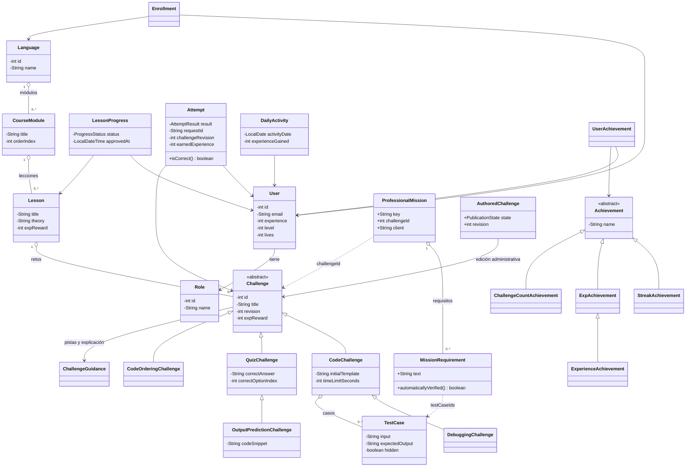
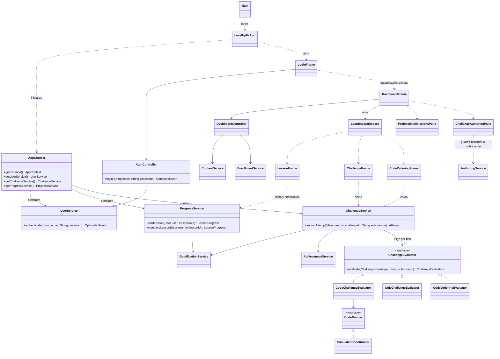

# Diagrama de clases de LevelUp Code

Clases principales de la versión actual del proyecto. El diagrama se presenta en tres vistas para seguir el dominio, el flujo de la aplicación y el acceso a Oracle por separado. Se muestran atributos y operaciones representativos.

## Modelo de dominio

`Enrollment` vincula usuario y lenguaje. `LessonProgress` relaciona usuario y lección. `Attempt` conserva cada envío y su revisión. Las misiones referencian el reto y los casos mediante identificadores.

## Inicio, pantallas y evaluación

Al enviar un reto, `ChallengeService` elige el evaluador según su tipo. El evaluador devuelve el veredicto en Java. El repositorio guarda el envío y Oracle aplica las reglas de gamificación.

## Repositorios y conexión con Oracle

```mermaid
classDiagram
    direction TB

    class UserRepository {
        <<interface>>
    }
    class ContentRepository {
        <<interface>>
    }
    class EnrollmentRepository {
        <<interface>>
    }
    class ProgressRepository {
        <<interface>>
    }
    class ChallengeRepository {
        <<interface>>
    }
    class AttemptRepository {
        <<interface>>
    }
    class AchievementRepository {
        <<interface>>
    }
    class ActivityRepository {
        <<interface>>
    }
    class ProfessionalMissionRepository {
        <<interface>>
    }
    class GenericDAO {
        <<interface>>
    }
    class OracleUserRepository
    class UserDAO
    class OracleContentRepository
    class OracleEnrollmentRepository
    class OracleProgressRepository
    class OracleChallengeRepository
    class OracleAttemptRepository
    class OracleAchievementRepository
    class OracleActivityRepository
    class OracleAuthoringRepository
    class OracleChallengeVersionRepository
    class OracleProfessionalMissionRepository
    class DemoProfessionalMissionRepository
    class OracleCalls {
        +cursor(Connection connection, String procedure, Object... inputs) CallableStatement
        +rows(CallableStatement statement) ResultSet
    }
    class DatabaseConnection {
        +getConnection() Connection
        +isDatabaseReady() boolean
    }
    class DatabaseDiagnostics

    UserService --> UserRepository
    ContentService --> ContentRepository
    EnrollmentService --> EnrollmentRepository
    ProgressService --> ProgressRepository
    ChallengeService --> ChallengeRepository
    ChallengeService --> AttemptRepository
    AchievementService --> AchievementRepository
    GamificationService --> ActivityRepository
    ProfessionalMissionsPane --> ProfessionalMissionRepository
    AuthoringService ..> OracleAuthoringRepository : guarda revisión
    OracleAuthoringRepository ..> OracleChallengeVersionRepository : registra versión

    UserRepository <|.. OracleUserRepository
    GenericDAO <|.. UserDAO
    OracleUserRepository --> UserDAO : delega
    ContentRepository <|.. OracleContentRepository
    EnrollmentRepository <|.. OracleEnrollmentRepository
    ProgressRepository <|.. OracleProgressRepository
    ChallengeRepository <|.. OracleChallengeRepository
    AttemptRepository <|.. OracleAttemptRepository
    AchievementRepository <|.. OracleAchievementRepository
    ActivityRepository <|.. OracleActivityRepository
    ProfessionalMissionRepository <|.. OracleProfessionalMissionRepository
    ProfessionalMissionRepository <|.. DemoProfessionalMissionRepository

    UserDAO ..> OracleCalls : consultas de usuario
    OracleContentRepository ..> OracleCalls : consultas de catálogo
    OracleChallengeRepository ..> OracleCalls : consultas de retos
    OracleProfessionalMissionRepository ..> OracleCalls : misiones publicadas
    OracleChallengeVersionRepository ..> OracleCalls : guarda y consulta versiones
    OracleProgressRepository ..> OracleCalls : consulta de progreso
    OracleAttemptRepository ..> OracleCalls : historial de intentos
    UserDAO ..> DatabaseConnection : obtiene conexión
    OracleAttemptRepository ..> DatabaseConnection : obtiene conexión
    OracleProgressRepository ..> DatabaseConnection : obtiene conexión
    DatabaseDiagnostics ..> DatabaseConnection
    DatabaseDiagnostics ..> OracleCalls
```

Los repositorios pasan una conexión JDBC a `OracleCalls` para consultar los paquetes de Oracle. Las operaciones de gamificación también se llaman mediante JDBC. [Guía de scripts y paquetes](../database/README.md).

| Otra pantalla | Clase de acceso a datos |
|---|---|
| `ChallengeAuthoringPane` | `OracleAuthoringRepository` y `OracleChallengeVersionRepository` |
| `CurriculumAuthoringPane` | `OracleCurriculumRepository` |
| `LearningAnalyticsPane` | `OracleLearningAnalyticsRepository` |
| `LearningGoalsPane` | `OracleGoalRepository` |
| `NotebookPane` | `OracleNotebookRepository` |
| `ProfilePane` | `OraclePreferenceRepository` para las preferencias del editor |
